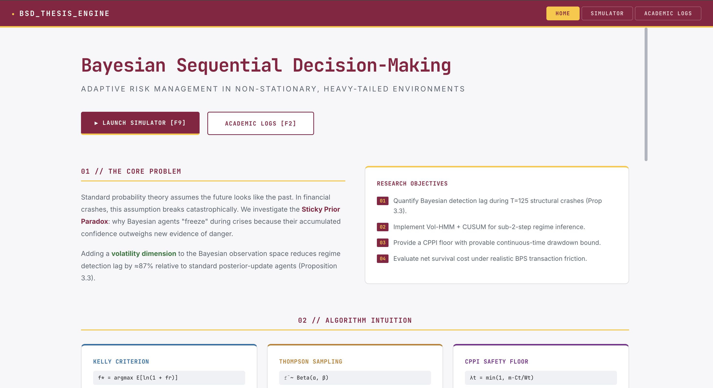

# Bayesian Sequential Decision-Making under Regime Switches

**Honors Thesis, School of Mathematics and Statistical Sciences, Arizona State University**

Studied Bayesian sequential decision-making under regime switches: an HMM regime detector with a
CUSUM change-point trigger feeding Kelly position sizing, evaluated by Monte Carlo on detection
delay, ruin and median wealth. This repository contains the code, LaTeX source and slides. All
results are from simulation. A React dashboard replays the experiments.



## What the thesis studies

- Why a Bayesian bettor adapts slowly after a regime shift (Thompson Sampling, Naive Bayes and other
  baselines in a simulated bull-to-bear break).
- A volatility-augmented hidden Markov model (Vol-HMM) with a CUSUM change-point trigger as the regime
  detector, and Kelly position sizing driven by it.
- Kelly sizing under a CPPI (constant proportion portfolio insurance) drawdown floor.
- Ruin under heavy tails when the Kelly fraction is computed under a Gaussian assumption.

Each method is evaluated by Monte Carlo on detection delay, ruin and median terminal wealth. The
thesis's own conclusion is in `final_thesis_work/thesis/06_conclusion.tex`.

**Status of the numbers (2026-10-13).** An audit found that the experiment script did not pass the
current wealth to the CPPI agent, so its floor never moved. The fix and a rerun of the original
experiments are in `final_thesis_work/audit/RERUN_cppi_floor.md`; that rerun's numbers were not
reproduced by an independent replication (the thesis text does not pin down the CPPI agent), so this
README quotes none of the thesis's original numbers; the thesis PDF reports them as defended. The
follow-up study below (Extension 2) was pre-registered, independently replicated and adversarially
reviewed, and its numbers are quoted with their conditions.

## Extension 2 (2026-10-13): a pre-registered ablation, synthetic data only

Code, specification and results: `final_thesis_work/ext2/` (`PREREG.md` frozen at 55498a2,
`CPPI_SPEC.md`, `RESULTS.md`, `COMMIT_MAP.md`; confirmatory run 043d02f), the independent replication in
`final_thesis_work/ext2_replication/` (written from `PREREG.md` and `CPPI_SPEC.md` only) and the
adversarial review in `final_thesis_work/ext2_adversarial/REPORT.md`. Every random generator is seeded;
2,000 paths per cell (confirmatory seeds 100000 to 101999), with every threshold tuned on separate
exploratory seeds 0 to 999.

**Return model (primary).** Returns are drawn as log returns, x from the thesis's distributions (bull
Gaussian, bear Student-t(3), same location and scale), and the simple return is r = exp(x) - 1 > -1. The
thesis's original model draws simple returns directly and allows r below -100%, which produced all of
its ruin events. Results under the original model are reported alongside in `RESULTS.md` as a
comparison only.

**Findings (replicated; synthetic; conditions stated).**
- At the thesis's persistence (A_ii = 0.95) and matched false-alarm rates (5 per 1,000 pre-break steps),
  neither the volatility feature nor the CUSUM trigger sped detection of the simulated break: the
  return-only HMM detected it 0.14 steps sooner than the Vol-HMM on average (95% CI 0.09 to 0.20; 87% of
  paths tied), and adding the CUSUM cost a further 0.23 steps. At A_ii = 0.99 the difference vanishes or
  reverses.
- At the thesis's own threshold (P(bear) > 0.5, no tuning; A_ii = 0.95; shock lasting to the end of the
  path) the volatility feature cuts false alarms from 26.4 to 2.1 per 1,000 pre-break steps, at the cost
  of a longer mean delay (2.7 vs 1.5 steps).
- On the same paths, removing the CPPI agent's 0.01 minimum leverage removes 86% of its floor breaches
  (99.7% at 50 rebalances per step); in the adversarial review, most breaches overshot the 20% floor by under
  1 percentage point.
- With the floor wired in, detection adds no median wealth for a shock that lasts, because the floor
  already cuts exposure; without the floor, the HMM detectors end with 8 to 9 times the median wealth of
  staying invested.
- Under bounded returns, ruin as the thesis defines it (1 + f r <= 0) cannot happen, since every bet is a
  fraction between 0 and 1.

**Disclosed deviation: the gap-risk analysis was changed after the exploratory run.** The specification
first tracked the agent's running peak at every rebalance inside a step (`peak_every`). On the
exploratory seeds that version failed its own negative control (rebalancing helped even against a
single jump, because the agent saw intra-step highs and raised its floor), so before the freeze the
primary analysis was changed to track the peak at step ends only (`peak_step`); `peak_every` was kept as a
secondary analysis. Both versions, confirmatory seeds, m = 3:

| version | thesis agent breach, 1 vs 50 rebalances per step | decision under the pre-registered rule |
|---|---|---|
| `peak_step` (primary after the change) | 0.607 vs 0.5625 | PARTLY SUPPORTED (rebalancing barely helps) |
| `peak_every` (as first specified) | 0.607 vs 0.037 | would have been SUPPORTED, but its jump control also falls (0.607 vs 0.2105) |

The pure CPPI variant (minimum leverage 0) gives 0.0835 vs 0.0015 under `peak_step`: classic gap risk.

**The CPPI agent as coded** (this corrects the thesis text, which describes a Gaussian Kelly fraction and
does not state the bounds; full specification in `final_thesis_work/ext2/CPPI_SPEC.md`):
- Base fraction: the even-money Kelly fraction of a Beta posterior on "the step return is positive",
  clip(2 a / (a + b) - 1, 0, 1), updated on the sign of each return only (r = 0 counts as a loss); not
  mu / sigma^2.
- Floor = 80% of the running peak of wealth; cushion C = W - floor; multiplier lambda = clip(3 C / W, 0.01,
  0.50), and lambda = 0.01 when C <= 0, so a small position stays open at or below the floor.
- Bet = lambda times the base fraction, always between 0 and 0.5; set once per step and held through the
  step; the agent receives its wealth after each step and updates its peak.
- Wealth evolves as log W += log(1 + f r); "ruin" means 1 + f r <= 0 (absorbing), not a floor breach.

## Reproduce

From `final_thesis_work/` with Python 3.10 and `requirements.txt` (rerun on 2026-10-12 with
numpy 2.2.6, scipy 1.15.3, numba 0.63.1):

```bash
python experiments/exp06_heavy_tails_fatality.py   # Kelly ruin under heavy tails, about 3 s
python experiments/generate_all_figures.py         # stationary / adversarial / drift tables and figures, about 40 s
python audit/audit_checks.py                       # audit replay of the adversarial scenario, about 3 min
```

Tables are written to `dashboard/frontend/public/results/tables/*_stats.json`. In these original
scripts Thompson Sampling and the Drift scenario use the unseeded global NumPy random generator, so
those numbers change from run to run (the dashboard outputs have not been regenerated); everything in
`ext2/` is seeded and bit-identical across runs.

## Limitations

- **Simulation only.** Every result comes from synthetic paths. The S&P 500 epochs are single paths,
  and the historical table in the thesis has no saved output here. Their return arrays are not stored in
  this repository: `python3 scripts/fetch_historical_data.py` (from `final_thesis_work/`, needs yfinance)
  downloads them and checks each against `data/historical/checksums.json`.
- **One stylised break.** A Gaussian bull regime followed by a Student-t(3) bear regime halfway
  through each path. Per-step moves are far larger than daily equity returns, and the two regimes are
  very different, which makes the break easy to detect.
- **The filter knows the true regimes.** The Vol-HMM emission parameters equal the parameters that
  generate the data (they are not estimated), so detection delay is a best case.
- **Small samples.** The adversarial and stationary runs use 100 paths per agent; the heavy-tail
  experiment uses 1,000.
- **Parameter choices.** Persistence, CUSUM threshold and drift, CPPI multiplier and floor were chosen
  by the author; the persistence and CUSUM sensitivity tables in the thesis have no generating script
  in this repository.
- **"Ruin" is a one-step wipeout** (1 + f r <= 0 in `simulation/wealth_tracker.py`), not a breach of
  the drawdown floor.
- **CPPI floor wiring.** The defended experiments called the CPPI agent's `update` without the current
  wealth, so its floor never moved and its leverage multiplier stayed at its cap. Fixed on this branch
  (`generate_all_figures.py` and the dashboard backend pass the wealth); a floor rebalanced once per step
  can still be breached, and the 0.01 minimum leverage causes most breaches (Extension 2).
- **Kelly fraction in Experiment 6** is the even-money fraction 2P(r > 0) - 1, not mu/sigma^2 as the
  thesis text describes.
- **Single asset, proportional fees only**, as the thesis notes in its own Limitations section.

## Project architecture

- **Simulation core (Python):** NumPy, SciPy, Numba. `simulation/hmm_refined.py` (Vol-HMM forward
  filter and CUSUM), `simulation/risk_constrained.py` (CPPI-scaled Kelly), `simulation/agents.py`
  (Thompson Sampling, Naive Bayes, EXP3, UCB, Softmax), `simulation/wealth_tracker.py` (log-space wealth).
- **Dashboard:** React/Vite frontend (`dashboard/frontend/`) and a Flask backend (`dashboard/backend/app.py`).

## Repository structure

```text
final_thesis_work/
  simulation/      Vol-HMM, CPPI agent, baseline agents, environments, wealth tracker
  experiments/     experiment scripts (exp01 to exp07) and generate_all_figures.py
  audit/           audit_checks.py and its outputs, CPPI rerun and its replication (2026-10-12)
  ext2/            Extension 2: pre-registration, CPPI spec, code, tests, results (2026-10-13)
  ext2_replication/, ext2_adversarial/   independent replication and adversarial review of ext2
  data/historical/ checksums of the S&P 500 return arrays (fetch with scripts/fetch_historical_data.py)
  dashboard/       React/Vite frontend and Flask backend
  thesis/          LaTeX source and compiled main.pdf
  presentation/    Beamer slides for the defense
```

## Run the dashboard locally

```bash
cd final_thesis_work/dashboard/backend && python3 app.py        # API on http://localhost:5001
cd final_thesis_work/dashboard/frontend && npm install && npm run dev   # UI on http://localhost:5173
```

---

**Author**: Ansh Dani  
**Thesis Committee**: [Dr. Shiwei Lan](https://math.la.asu.edu/~slan/) (Thesis Director) and [Dr. Nicolas Lanchier](https://math.la.asu.edu/~lanchier/) (Second Reader)  
**Institution**: [School of Mathematics and Statistical Sciences](https://math.asu.edu/) (Arizona State University)
